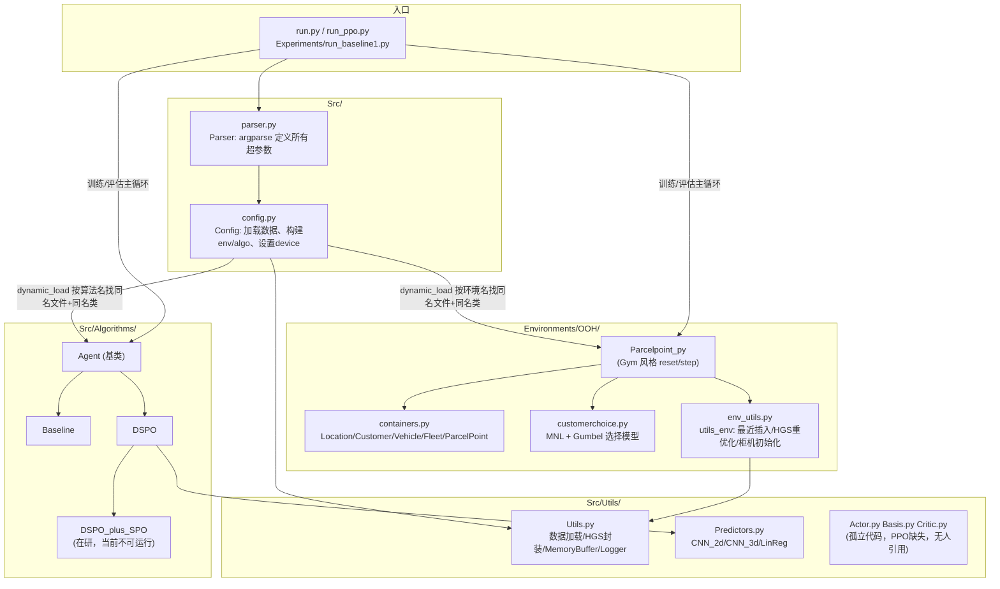
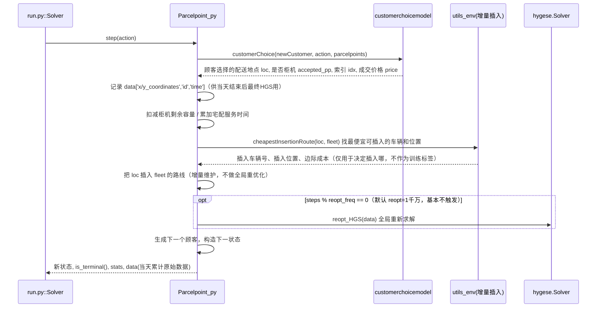
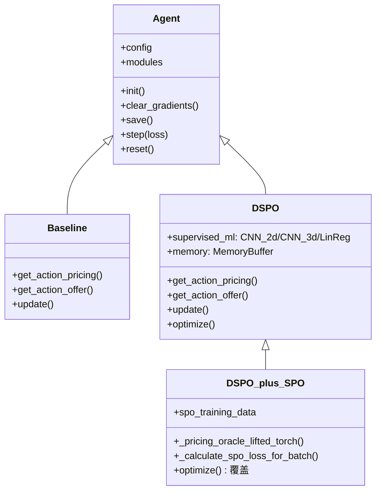

# OOH 项目架构与算法流程说明

> 本文档基于对当前代码库（非论文、非 manuscript）的实际阅读整理，目的是把"代码里到底在做什么"讲清楚。
> 涉及成本口径是否与 Akkerman 原论文/manuscript 对齐的问题，不在本文讨论范围内，权威结论见 [`cost_alignment_audit.md`](./cost_alignment_audit.md)；本文只描述当前实现的**流程和公式本身**。
> 已知的代码缺陷/未接入功能见文末"现状与已知问题"一节，也可参考仓库根目录 `CLAUDE.md`。

---

## 1. 总体架构



**关键机制：动态加载（务必了解，否则调试时会很困惑）**

`Src/config.py` 不是 `import DSPO` 这样直接引用类，而是调用 `Utils.dynamic_load(dir, name, load_class=True)`：

1. 在给定目录下**递归搜索文件名包含 `name` 子串的文件**（`Utils.py::search`，不是精确匹配，也不是搜索类名）。
2. 对该文件所在模块做 `getattr(module, name)`，取出**同名类**。

所以 `--algo_name DSPO` 之所以能工作，是因为 `Src/Algorithms/DSPO.py` 里恰好有一个叫 `DSPO` 的类。这个机制天然存在两个风险：
- 传入的名字必须在某个文件里能作为**子串**匹配到，且该模块里要有**同名类**，两者缺一都会报 `ValueError: Failed to dynamically load the class`。
- 如果目录下有多个文件名都包含该子串（比如 `DSPO.py` 和 `DSPO_plus_SPO.py` 都包含 `"DSPO"`），命中哪个取决于 `os.listdir` 的顺序，存在歧义。

`dynamic_load` 还要求代码所在绝对路径中必须有一段精确等于 `ooh_code`（用来切割出可 import 的相对模块路径），因此**根目录名必须叫 `ooh_code`**，这也是 `README.md` 里提到的注意事项的来源。

---

## 2. 配置层：Parser → Config

- `Src/parser.py`：纯粹是 `argparse` 定义，没有配置文件。所有超参数（环境参数、DSPO参数、Heuristic参数、Baseline参数、PPO参数）都在这里用 `add_argument` 声明默认值。
- `Src/config.py::Config.__init__`：
  1. 设随机种子（`np.random.seed` / `torch.manual_seed`）。
  2. 按 `args.experiment + args.folder_suffix` 拼实验目录，创建 `Logs/Checkpoints/Results` 三个子目录，并把 `sys.stdout` 重定向到自定义 `Logger`（同时写终端和文件，取决于 `--log_output`）。
  3. 如果 `--load_data=True`（默认），调用 `Utils.load_demand_data` 分别加载训练用种子（`data_seed`）和测试用种子（`data_seed_test`）的数据——**这意味着训练环境和测试环境用的是同一实例（如 RC）但不同的随机种子文件**，不是同一份数据的 train/test 划分。
  4. 通过 `get_domain` 构造 `self.env`（训练用）和 `self.test_env`（测试用），两者是**两个独立的 `Parcelpoint_py` 实例**，各自维护自己的车队/柜机状态。
  5. 用 `dynamic_load` 按 `--algo_name` 取出算法类，赋给 `self.algo`（注意这里只是拿到**类**，真正实例化 `self.model = config.algo(config=config)` 是在 `run.py::Solver.__init__` 里做的）。
  6. 决定 `self.device`（仅当 `--gpu` 非 0 且 CUDA 可用时才是 `cuda:0`，否则永远是 CPU，即便机器上有显卡）。

---

## 3. 环境层：`Parcelpoint_py`（一天的配送模拟）

### 3.1 一个 episode 代表"一天的预约窗口"

- `reset()`：用负二项分布 `NB(max_steps_r, max_steps_p)` 采样这一天最多来多少个顾客（`self.max_steps`），重置车队路线为空、柜机剩余容量恢复满值。
- 真正的循环终止条件由**两处**共同决定（容易踩坑）：
  - 环境自身：`is_terminal()` 判断 `self.steps > self.max_steps`（即达到当天负二项分布采样出的顾客数上限）。
  - 调用方（`run.py::Solver`）：`self.max_steps = n_vehicles * veh_capacity - 1`（车队总容量上限），循环里 `if step >= self.max_steps or done: break`。
  - 实际生产中往往是**车队容量上限先触发**（因为默认 `max_steps_r=700` 是为 Amazon 大实例设的，用在 90 节点的 RC 实例上时环境本身几乎不会先到达 `max_steps`）。

### 3.2 `step(action)` 内部流程



- 顾客选择模型（`customerchoice.py`）用 **MNL + Gumbel(0,1) 噪声** 做离散选择模拟：
  - Offer 模式（`customerchoice_offer`）：只有"给不给顾客提供某个柜机"的0/1决策，效用 = `base_util + mnl(distance)`，无价格项。
  - Pricing 模式（`customerchoice_pricing`，当前默认 `--pricing True`）：效用额外加上 `incentiveSensitivity * price`，价格由算法给出的向量 `action`（`[home价格, pp_1价格, ..., pp_k价格]`）决定。
  - 两种模式都是每个候选项效用 + Gumbel 噪声后取 `argmax`，即标准的 Gumbel-Max 采样，等价于按 softmax 概率抽样。
- 当天结束（episode done）后，算法的 `update(data, state, done=True)` 会用**完整一天的路径原始数据**（`data['x_coordinates'/'y_coordinates'/'id'/'time']`）调用 HGS 做一次**最终重优化**，得到当天真实的总行驶成本，这个值才是训练/评估里当作"真实成本"的来源（区别于 `step()` 里维护的"临时插入路线"，那只是给下一步决策用的近似）。

### 3.3 柜机（ParcelPoint）容量与"最近 k 个"

- `--fraction_capacitated` 决定多少比例的柜机是"有限容量"的（其余视为无限容量 `1e6`），具体哪些柜机被设为有限容量由 `env_utils.py::generate_fixed_list` 用 `hash((length, fraction))` 做的**确定性伪随机**决定（同样的 `n_parcelpoints`/`fraction_capacitated` 组合每次结果一致，不受 `--seed` 影响）。
- `--k` 控制向顾客展示/定价多少个候选柜机；对 Amazon 实例（Austin/Seattle）会先用预先存好的 `adjacency20.npy`（20 个最近柜机）过滤，再从中选 `k` 个；对 Homberger-Gehring 实例（C/R/RC），因为只有 10 个柜机，`adjacency` 矩阵全 1，相当于**始终全量展示这 10 个柜机**，`--k` 在这三个实例上基本不起筛选作用。

---

## 4. 算法层

### 4.1 类继承关系



### 4.2 Baseline：无学习的对照组

固定策略：宅配报价恒为 `--price_home`，柜机报价恒为 `--price_pp`（offer 模式则是"选最近的 k 个柜机"）。每个 episode 结束时用 HGS 做一次最终重优化拿到成本，不做任何参数更新——`self.modules = []`，所以 `Agent` 基类里的存档/梯度逻辑对它来说都是空操作。用途是作为"完全不学习、不依赖预测"的成本基准。

### 4.3 DSPO：论文核心贡献

#### (a) 状态特征：把"当前路线"变成一张图

`get_feature_rep` / `get_feature_rep_infer` 把当前车队所有已访问点，按：
- **时间维度**：到达时刻 `time` 除以 `interval = max_steps_r / n_input_layers`，分到 `n_input_layers` 个时间桶；
- **空间维度**：坐标通过 `get_matrix`（把经纬度线性映射到 `grid_dim × grid_dim` 网格，可选六边形网格但论文未使用）落到某个格子；

累加计数，得到形状 `(n_input_layers, grid_dim, grid_dim)` 的密度图张量，作为 CNN（`CNN_2d`，或 `CNN_3d`/`LinReg` 变体）的输入，外加一个"该候选点插入后剩余容量"的标量特征一起喂进网络，输出一个标量，语义是**"在当前路线状态下，把这个候选点也捎带上的边际路由成本"预测值**。

#### (b) Offer 决策（`--pricing False`）

```
theta = init_theta_cnn - steps * cool_theta_cnn   # 随时间线性冷却
pp_costs = (1-theta) * 最便宜插入成本(启发式) + theta * (CNN预测的边际成本)
选 pp_costs 最小的 k 个柜机作为 offer 集合
```
`theta` 从 `init_theta_cnn`（默认 0.75）线性降到接近 0，即**训练初期更信任"最便宜插入"这个启发式，训练越往后越信任 CNN 预测**，是一种从启发式到学习模型的渐进切换（而非固定权重融合）。

#### (c) Pricing 决策（`--pricing True`，默认模式）

对每个候选项（宅配 + 各柜机）算出同样的融合成本 `c_i`（启发式 + CNN 预测，按 theta 加权），代入 MNL 选择模型的**闭式定价公式**：

```
S = Σ_i exp(u_i + incentive_sens * (c_i - revenue))         # 对所有候选项的效用求和（不含被求解价格本身）
λ0 = ( W0(S / e) + 1 ) / incentive_sens                     # Lambert W 函数的主分支
price_i = clip( c_i - revenue - λ0 , min_price, max_price )
```

这是在给定"预测成本向量"的条件下，让"顾客按 MNL 选择 + 报价最大化平台预期利润"这一优化问题的**解析解**（Lambert-W 是因为 MNL 的一阶条件里出现了 `x*e^x` 形式）。直觉上：`c_i - revenue` 是"如果这个选项被选中，平台的净成本"，`λ0` 是一个所有候选项共享的"整体折让基准"，柜机/宅配之间的相对价格差完全由预测成本差决定。

`initial_phase`（初始阶段）时直接报价全 0（不折不扣），只是为了尽快收集 `(状态特征, 真实成本标签)` 样本去把 CNN 预训练到收敛，这段时间不做决策优化，纯粹是数据采集。

#### (d) 训练标签：半边分摊（HEP），不是论文的 leave-one-out

`update(data, state, done=True)` 时：
1. 用**完整一天的路线数据**调用 HGS 做一次最终重优化，得到 `fleet`。
2. `get_per_customer_costs(fleet, id_counts)`：对每辆车的路线，把每条边的距离成本**各分一半给相邻的两个访问点**（第一个点分到"仓库→它"的一半 + "它→下一个点"的一半，以此类推），得到"每个顾客被服务的边际成本"近似值；此外每个停靠点还计入服务时长成本——上门客户计全额 lᵢ，OOH 停靠按当期使用该点的顾客数（`id_counts`，由 `data['id']` 的 Counter 得到）摊销（2026-07-25 paper-repro 分支新增）。
3. 这个值加上一个"剩余容量惩罚"（`20 / (剩余容量+0.1)`，容量越低惩罚越大，用于抑制往快满的柜机分配过多顾客）后，连同当天采集的空间特征一起存进 `MemoryBuffer`。

代码里明确注释说明：这是为了训练效率而采用的近似（"Half-edge partitioning, HEP"），与论文实验里用的方法不同，**可能带来一定的效果损失**（作者原话）。

#### (e) 训练循环

- **初始阶段**：每个 episode 结束都把当天样本推入 buffer；一旦 `memory.length >= buffer_size`（默认 500），进入 `initial_phase_training`：连续多轮（最多 `initial_phase_epochs` 轮，默认 50）在整个 buffer 上做 Huber Loss 训练，每轮内部按 `batch_size` 分批；如果最近 10 轮均值不再显著下降（`最近10轮均值 + 1e-5 >= 最近20轮均值`）就提前收敛退出；训练完把 `initial_phase` 置为 `False`，之后不再进入这个分支。
- **在线阶段**（若 `--only_phase_one=False`）：此后每个 episode 结束都只做**一次**梯度更新（`optimize()`：从 buffer 里随机采一个 batch，做一次 Huber Loss 反传），不是每步都更新。

### 4.4 DSPO_plus_SPO：在研的 "lifted SPO+" 扩展（当前不可运行）

这是为后续论文章节（DRT/通勤场景）准备的对 `DSPO` 的子类化扩展，核心想法是在原有 Huber Loss（"预测成本准不准"）之外，叠加一个 **SPO+ (Smart Predict-then-Optimize Plus)** 损失（"由预测成本导出的定价决策，效果是否接近由真实成本导出的定价决策"），即**决策感知（decision-aware）学习**而非纯预测准确度学习。

关键设计（源码注释与实现）：
- **lifted decision** `w(a) = [P(a), -R0(a)]`：`P(a)` 是给定成本向量下、走一遍定价 oracle（跟线上部署同一套 clipped Lambert-W 规则）算出的各候选项 MNL 选择概率，`R0(a)` 是对应的期望收入；把"定价决策"提升（lift）成一个概率单纯形 + 负收入构成的向量，这样才能用线性形式的 SPO+ 次梯度公式。
- **warmup → rampup → 混合**：`spo_warmup_episodes` 轮内 SPO+ 权重为 0（只训 Huber）；之后 `spo_rampup_episodes` 轮内权重从 0 线性升到 `spo_loss_weight`（默认 0.7）；SPO+ 反传和 Huber 反传是**两次独立的前向/反向**（`self_supervised_update` 里分别 `.backward()`），用来降低峰值显存占用。
- **训练用的"真实成本"来自终局路线的反事实边际插入成本**（`_calculate_global_costs_for_all_options_spo`）：对每个到达的顾客，把它从最终路线里摘掉，重新计算"每个候选项（宅配+各柜机）插回这条已摘除的路线"的最便宜插入增量，作为该顾客在该候选项下的真实成本——这比 DSPO 的 HEP 近似更接近论文/manuscript 里"每个候选点都要有真实成本"的要求，但仍是启发式插入而非重新精确求解 CVRP。

**当前状态（务必先读 `CLAUDE.md` 的"Known gaps"）**：
- `--algo_name` 的 `choices` 列表里**没有** `DSPO_plus_SPO`，无法直接通过命令行选中，需要手动改 `parser.py`。
- 该文件顶部 `from Src.Utils.passenger_utility import utility_home_nonprice`，但仓库里**没有** `Src/Utils/passenger_utility.py` 这个文件，import 会直接失败。
- 代码里大量使用 `self.l0_home`、`self.l_mp`、`self.use_travel_time_prediction`，但这三个属性**在 `__init__` 里从未被赋值**（`DSPO_plus_SPO.__init__` 和父类 `DSPO.__init__` 都没有设置），一旦跑到 `get_action_pricing`/`update` 会抛 `AttributeError`。
- 结论：这是一份**正在开发中、尚未接线完成**的代码，不要当作"当前可跑的 SPO+ baseline"去对比实验结果。

---

## 5. Utils 层速查

| 文件 | 作用 |
|---|---|
| `Utils.py` | 数据加载（`load_demand_data`/`generate_demand_data`）、服务时间生成（六峰驼背函数投影）、HGS 相关封装（`get_dist_mat_HGS`/`extract_route_HGS`/`writeCVRPLIB`/`readCVRPLIB`）、日志重定向 `Logger`、训练样本容器 `MemoryBuffer`（含存取/持久化）、`NeuralNet` 基类（统一 save/load/optim.step 接口）、画图函数 |
| `Predictors.py` | `LinReg`/`CNN_2d`/`CNN_3d` 三种成本预测器结构，`forward(x, capacity)` 都是"空间-时间密度图 + 剩余容量标量 → 一个标量成本预测" |
| `Actor.py`/`Basis.py`/`Critic.py` | Fourier 基 + 高斯 Actor/Critic，是 README 里描述的 PPO 策略的组成部分，但**当前仓库里没有任何地方 import 它们**（`PPO.py` 本身也不存在），属于孤立代码 |

---

## 6. 现状与已知问题（精简版，详见 `CLAUDE.md` / `cost_alignment_audit.md`）

1. **`--algo_name` 里 `Heuristic`/`PPO`/`SPO` 三个选项当前都跑不通**：对应源文件在仓库里不存在（`Heuristic.py`、`PPO.py` 从未出现；`SPO.py` 曾经存在，仅剩 `__pycache__` 残留的 `.pyc`）。目前能正常动态加载的只有 `DSPO` 和 `Baseline`。
2. **`run_ppo.py` 因此也无法运行**，它硬依赖 `--algo_name PPO`。
3. **`DSPO_plus_SPO` 未接入 parser 选项，且有真实的 `ImportError`/`AttributeError`**，见第 4.4 节。
4. **成本口径曾存在多处未对齐**（附加费符号、accepted price 索引错位、六峰函数笔误、DSPO home 分支缺量纲系数、eval 用训练环境而非测试环境重优化等）——这几处已经修复。仍然**未修**、且需要先做设计决策才能修的：OOH 配送服务时间恒为 0（缺"按访问点分摊"的具体公式）、Homberger-Gehring 数据集下 `dist_matrix` 存的是时间而非距离导致燃油按时间计费。任何"复现论文数字"或"对比 DSPO vs Baseline 净利润"的结论都必须先看过 `cost_alignment_audit.md` 确认当前还剩哪些未对齐项，不能直接相信 `run.py` 输出。
5. **`Environments/OOH/yanjiao/`** 下的燕郊通勤数据（住宅簇候选点、公交站候选点 CSV）是通过高德 API 采集的原始数据，**目前没有任何 Python 代码读取它**，是为后续场景准备的素材，尚未接入 `Parcelpoint_py`/`load_demand_data`。
6. **本机环境**：本项目本地用 `conda activate py39` 运行；GPU 训练需要显式传 `--gpu 1`（默认即使有 CUDA 也用 CPU）。`hygese` 在此机器上无法用 `pip install hygese` 直接装（其 `setup.py` 在构建期用 `urllib.request` 从 GitHub 下载 HGS-CVRP 源码再用 cmake+make 编译，而本机 Windows 证书库里有损坏证书导致所有 `urllib` 发起的 HTTPS 请求失败），已改为手动下载源码、用本机 `cmake`+MinGW 编译出 `libhgscvrp.dll`，再从本地路径 `pip install` 打包好的 `hygese` 目录来绕过这个构建期下载步骤。
